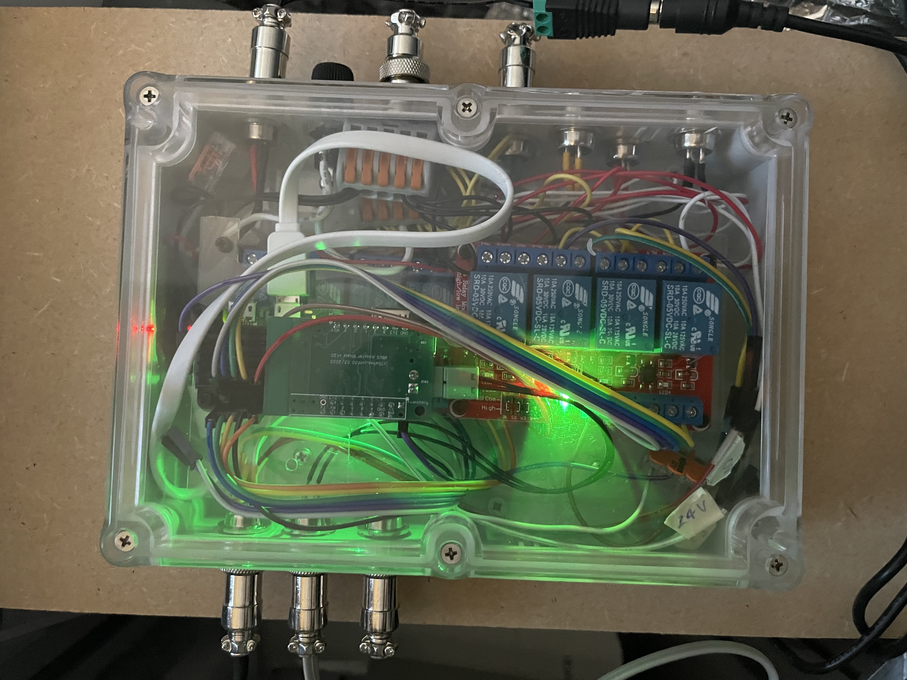
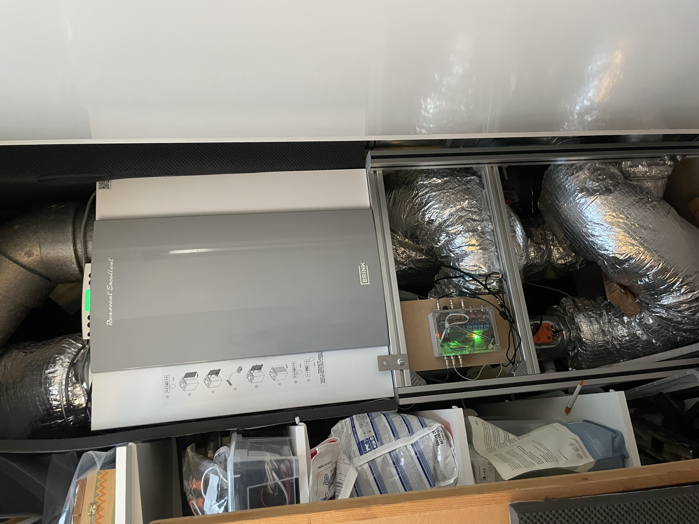
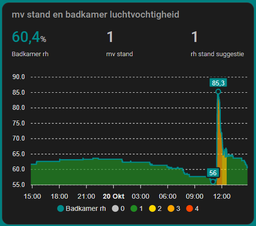
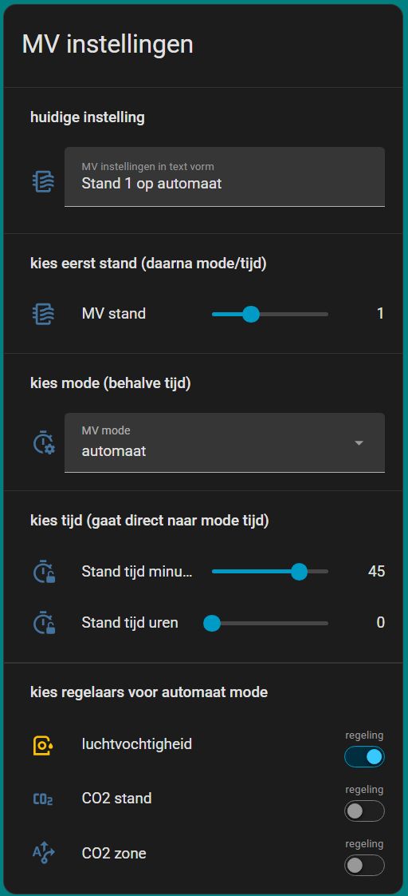
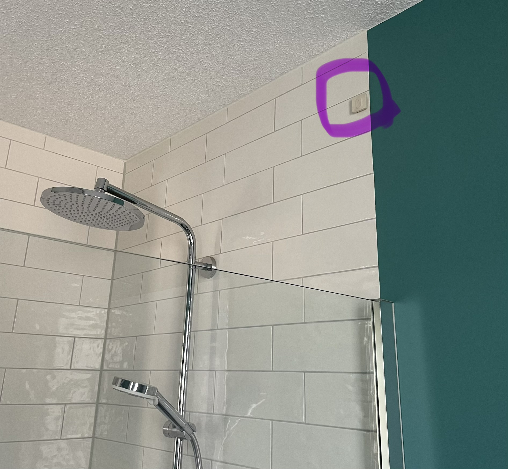
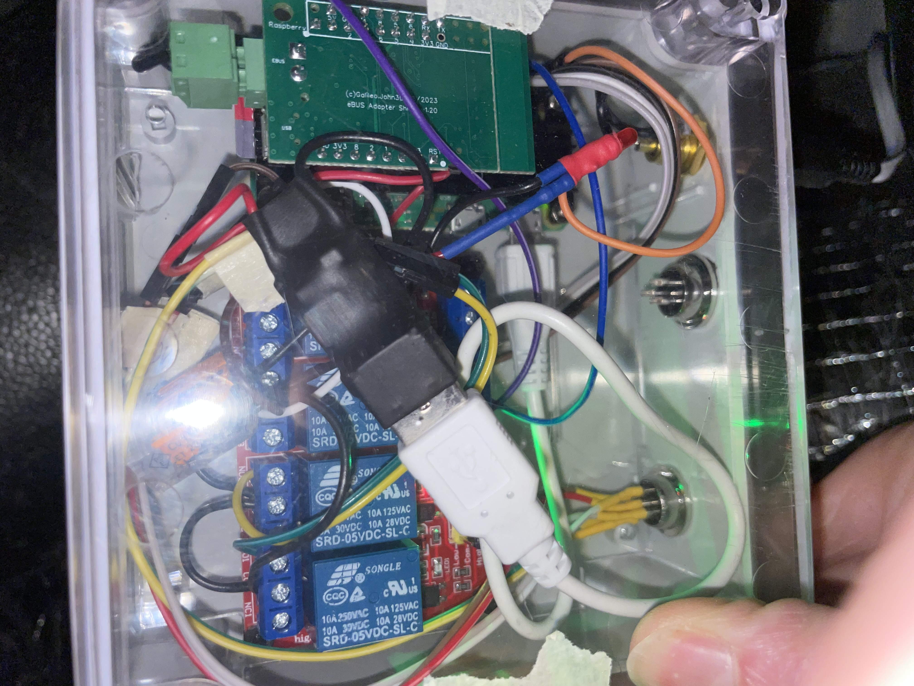
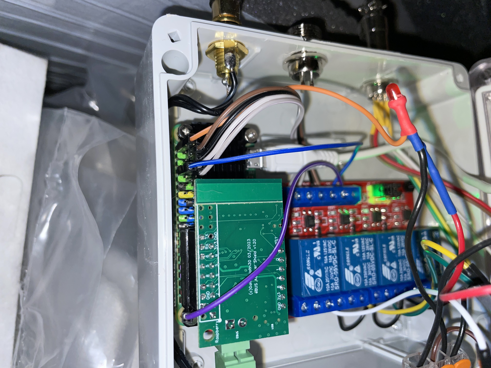
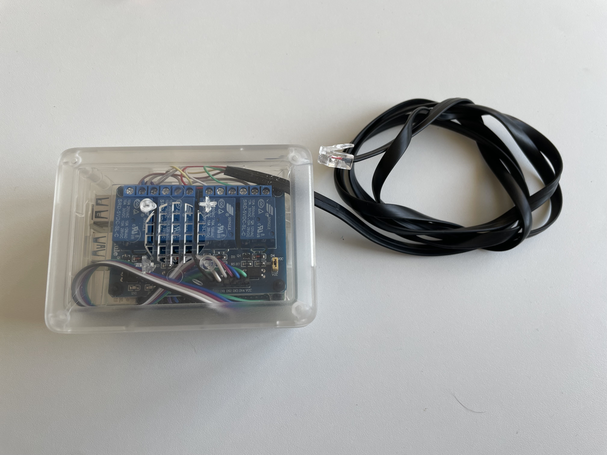
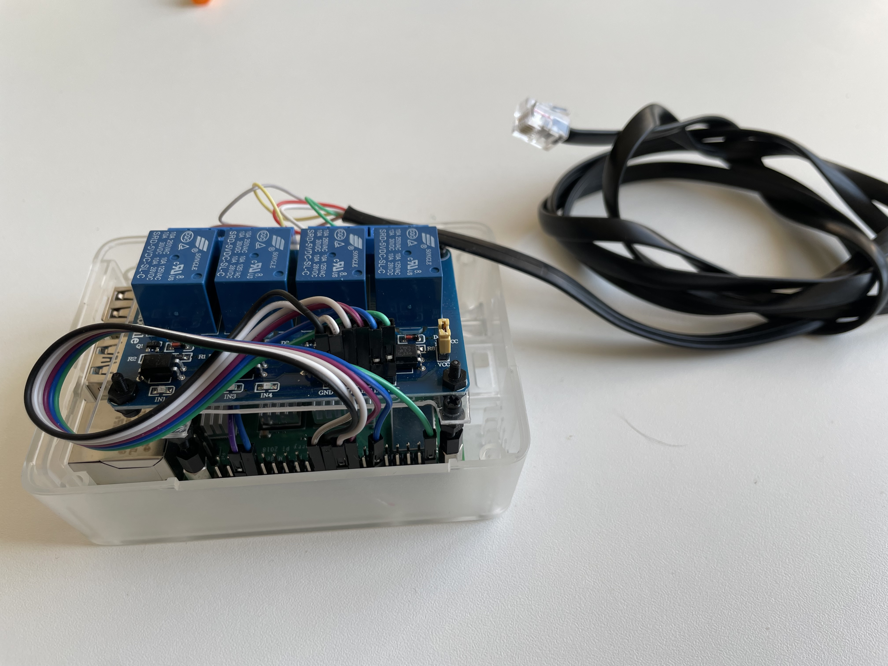

# MVcontroller

**Work in progress:** This README and the project documentation are being established. Hardware specifications, wiring details, and installation instructions are incomplete and marked TBD where they are not yet verified.

The **MVcontroller** is a Raspberry Pi-based controller for connecting a mechanical ventilation system to Home Assistant. Its design has evolved from a humidity-controlled fan using a custom REST/GPIO backend to a reusable MQTT device architecture based on [HMD-DGB](https://github.com/jvanoosterhout/HMD-DGB).

**Status:** HMD-DGB beta testing is in progress. The controller hardware and historical software designs are still being documented.

## Project Map

- **Project overview and development history:** [Overview](#overview) and [History & Design Evolution](#history--design-evolution)
- **Hardware and build:** [hardware/README.md](hardware/README.md)
- **Wiring sources and diagram output:** [hardware/wiring/README.md](hardware/wiring/README.md)
- **Bill of materials:** [hardware/bom.csv](hardware/bom.csv)
- **Software and Home Assistant notes:** [software/README.md](software/README.md) and [docs/README.md](docs/README.md)
- **Project documentation:** [docs/](docs/)
- **Changelog:** [CHANGELOG.md](CHANGELOG.md)

## Overview

MV stands for Mechanical Ventilation. The project connects a home Heat Recovery Unit (HRU) with in- and out-flow and its controls to Home Assistant. The initial goal was to control a mechanical-ventilation fan in four states based on humidity. Current work explores controlling ventilation valves with common valves and Belimo actuators after the existing CO2-controlled demand valve failed. Also demand controled zone ventilation based on CO2 levels is on the whish list. 

The system is intended to separate responsibilities: Home Assistant handles higher-level automations, while the DGB service exposes the controller as a device and manages hardware-specific pin bindings. High level automation bassically means to determine the right fan state based on (bathroom) humidity, CO2 in a zone and time of the day. The current node still runs the former REST API with generick GPIO backend. Valves are not jet operational. Waiting for MHD-DGB update with time-based covers to allow partially closed valves. 






### History & Design Evolution

#### 2025: Reusable GPIO service and MQTT exploration

In Q1 2025, addapted the new [Shelly BLU H&T](https://www.shelly.com/products/shelly-blu-h-t-ivory). A maijor relief for the sensor side. The other sensor sometimes mised updates and could not be placed well in the bathroom. This H&T sensor is taped nice to the bathroom wall sinds 2025. A downside is that it requires a filter on the measuremnts for the fan state alrorithem to work. 



In Q4 2025, MQTT discovery was explored with ebusd. Seeing related entities grouped under one Home Assistant device helped motivate a broader design change: Raspberry Pi controllers should act as service hubs, with device configuration and pin bindings managed by the Pi and meaningful devices presented to Home Assistant.


#### 2024: Pin model and hardware redesign

The software generalized pin control behind the REST API and introduced a pin-configuration model. Home Assistant took over higher-level behavior such as humidity-based state controller. Each command to the service would sent the full pin configuration so the controller could resume correctly after a restart or power outage., but configuration and entities still required significant manual management in Home Assistant.

Additionally the controller was extended with the [eBUS adapter](https://adapter.ebusd.eu/v5/index.en.html). This required more room than the V1 casing had or could ever get. 

The MV hardware was redesigned around a Raspberry Pi Zero 2 W in a bigger, but still compact, enclosure. It was powered from the ventilation unit's 24 V supply through a 24V-to-5V buck converter. A GX12-6 connector was used for the connection to the ventilation equipment. 




Later in 2024, work on the ventilation system itself revealed that its CO2-controlled demand valve had failed and that the existing CO2 sensors and replacement valve were costly. A further hardware redesign was planned to use common valves and Belimo actuators, requiring more relays and an even larger enclosure.

#### 2024: Unifying GPIO control

Experience with multiple controllers and updates showed that maintaining a custom backend per use case would become difficult. The design goal changed to have one GPIO backend that could support different pin types and configurations. A Raspberry Pi Zero 2 W and SSH-based maintenance were explored to reduce the size and power consumption compared with a Pi 4.

#### January 2022: First MV controller

The MV controller used Raspberry Pi GPIO through a custom REST API. The API was intended to provide a simple `get_state` / `set_state` interface, while a custom backend controlled the GPIO pins. The controller was placed in a simple jet expandable case. It was a first attempt a long struggle finding simple cases that would easily fit a Pi and some simple hardware. 




#### December 2021: System goals

The wider home-automation system was planned for several years. Within our new home the ventilation unit was the first device to be integrated in Home Assistant. The early MV plan was a four-state fan controlled based on humidity levels in the bathroom. Raspberry Pi 4, Poe HAT, relays, Python, and a simple REST API were explored as an accessible and flexible alternative to expensive proprietary controller from the manufaturer. Humidity sensing was done by [Shelly H&T Gen3](https://www.shelly.com/products/shelly-h-t-gen3-matte-white?variant=56273481335133), a bulky sensor for it purpose. 

## Requirements / Functionality

- Control a mechanical-ventilation fan with four states: away, normal, increased, max.
- Automate fan control based on humidity in the bathroom
- Automate fan control based on CO2 in living zones
- Automate zone control based on CO2 in living zones
- Expose ventilation equipment to Home Assistant through MQTT devices.
- Explore controlling ventilation zones by common valves using Belimo actuators.

## Hardware Design

### Bill of Materials

The BOM is stored in [hardware/bom.csv](hardware/bom.csv). The table below is generated from that file.

<!-- BOM:START -->

| Category | Component | Details | Qty | Status | Notes |
|----------|-----------|---------|-----|--------|-------|
| controller | Raspberry Pi Zero 2 W | Controller platform | 1 | required | Confirm current hardware revision |
| thermal | [Waveshare aluminium heatsink](https://elektronicavoorjou.nl/product/heatsink-raspberry-pi-zero/) | Thermal management | 1 | required | For Raspberry Pi Zero 2 W |
| controller | [eBUS adapter](https://adapter.ebusd.eu/v5/index.en.html) |   |  1 |   |   |
| power | [DC-DC buck converter](https://www.tinytronics.nl/nl/power/spanningsconverters/buck-(step-down)-converters/dc-dc-step-down-buck-converter-2a-5v-met-usb) | 24 V to 5 V for Raspberry Pi | 1 |  | Confirm input range output current and isolation |
| power | [Panel-Mount Fuse Holders with screw cap](https://elektronica-online.nl/product/zekeringhouder-4590) |  | 1 |   |   |
| power | [Glass fuse 5x20mm 1A fast](https://elektronica-online.nl/product/10-zekeringen-1a-snel-5x20--4411) |  | 1 |   |   |
| connector | [GX12-6](https://www.tinytronics.nl/en/cables-and-connectors/connectors/aviation-style/gx12/gx12-6-connector-set) | Connector towards HRU | 1 | required | Confirm pin assignment and current revision |
| connector | [GX12-3](https://www.tinytronics.nl/en/cables-and-connectors/connectors/aviation-style/gx12/gx12-3-connector-set) | Connector towards Belimo actuator | 4 | required | Confirm pin assignment and current revision |
| connector | [GX12-2](https://www.tinytronics.nl/en/cables-and-connectors/connectors/aviation-style/gx12/gx12-2-connector-set) | Connector for power and ebus signal | 2 | required | Confirm pin assignment and current revision |
| control | [5V 8-channel relay module](https://www.berrybase.de/en/5v-8-channel-relay-module-with-definable-switching-signal-high-low) |  | 1 | required |  |
| control | [5V 4-channel relay module](https://www.berrybase.de/en/5v-4-channel-relay-module-with-definable-switching-signal-high-low) |  | 1 | required |  |
| actuator | [Belimo actuator](https://www.berrybase.de/en/5v-4-channel-relay-module-with-definable-switching-signal-high-low) | Planned valve actuator | 4 |  | Select and document exact model control signal and power requirements |
| sensor | [Shelly BLU H&T](https://www.shelly.com/products/shelly-blu-h-t-ivory) |   |  1 | required |   |
| enclosure | Kradex enclosure | Larger enclosure planned for expanded relay count | 1 | required | 176 x 126 x 57 mm IP65 |
| assembly | Wago clamps | Terminal connections | as required | required |  |
| assembly | Jumper cables heat shrink and masking tape | Wiring and assembly | as required | required |  |

<!-- BOM:END -->

Regenerate this table after changing the CSV with:

```sh
python3 software/generate-bom-table.py
```

### Required Tools
- 13mm drill
- 3mm drill
- File (to make drill holes square)
- Soldering iron
- Wire stripper
- Screwdrivers
- Digital multimeter (for safety verification)

---
## Pinout & Wiring

### GPIO Assignments

| Function | GPIO (BCM) | Notes |
|----------|------|-------|
| HRU fan state 0 | GPIO 26 | |
| HRU fan state 1 | is default state |  |
| HRU fan state 2 | GPIO 19 |  |
| HRU fan state 3 | GPIO 13 |  |
| CO2 zone valve bedrooms open | GPIO 16 |  |
| CO2 zone valve bedrooms close | GPIO 12 |  |
| CO2 zone valve bedrooms stop | is default state |  |
| CO2 zone valve bedrooms open | GPIO 6 |  |
| CO2 zone valve bedrooms close | GPIO 5 |  |
| CO2 zone valve bedrooms stop | is default state |  |

### MV wiring 

white - 24v
brown - GND
green - fan state 0
gray - fan state 3
yellow - fan state 2
red - Filter saturation signal


### Belimo valve wiring

In casing
Pin 1 - zwart??
Pin 2 - rood?
Pin 3 - wit ??

Belimo motor lm24a
1 = zwart
2 = rood
3 = wit

## Software Setup
### Prerequisites
- Home Assistant running
- MQTT broker running
- Raspberry Pi OS Bookworm 32-bit (lite)
- Python 3.10

### Installation
Run the installer on the Raspberry Pi. It creates a local virtual environment, installs the current HMD-DGB version from GitHub, and creates and enables a systemd service. I recommend performing the setup over SSH.

```sh
git clone https://github.com/jvanoosterhout/MVcontroller.git
cd MVcontroller
sudo ./software/install.sh \
   --service-name MVcontroller \
   --broker 192.0.2.10 \
   --port 1883 \
   --username mqtt_user \
   --password 'change-me' \
   --location MVkast \
   --rate 300
```

Replace the example broker, username, and password with your own values. The installer accepts configuration through command-line options and stores it in `/etc/MVcontroller.env` with root-only permissions. A python venv is placed by default in /opt/MVcontroller (or the name us chose), but this can be changed with the `--install-dir` option. Check the service with `sudo systemctl status MVcontroller` and view its logs with `sudo journalctl -u MVcontroller`.

### Configuration
<!-- After installation, create a Home Assistant automation in YAML mode and paste or adapt the configuration in [software/home-assistant-DGB-config-automation.yaml](software/home-assistant-DGB-config-automation.yaml). It publishes the retained MQTT configuration for the garage-door cover, lock switch, and closed-state sensor. The automation examples in [software/home-assistant-automation-helpers.md](software/home-assistant-automation-helpers.md) show how to operate the door and send an alert if it remains open. -->

### Home Assistant Integration
<!-- The MQTT configuration exposes the HRU as a cover and provides a switch to temporarily enable operation. Adapt the example automations to your Home Assistant entities and notification service. -->

### Updating HMD-DGB
From the installation directory on the Pi, activate the virtual environment and upgrade HMD-DGB:

```sh
source venv/bin/activate
pip install --upgrade git+https://github.com/jvanoosterhout/HMD-DGB.git
sudo systemctl restart MVcontroller
```

### Home Assistant Interface

Home Assistant discovers the HMD-DGB node and service devices. The garage-door configuration adds a cover, a lock switch, and a binary sensor that reports whether the door is closed.

---

## Related Projects

- [DGB-systems](https://github.com/jvanoosterhout/DGB-systems) - System-wide context, architecture, and design history
- [HMD-DGB](https://github.com/jvanoosterhout/HMD-DGB) - MQTT-based home automation device platform
- [Gcontroller](https://github.com/jvanoosterhout/Gcontroller) - Garage-door and garden-irrigation controller
- [MKcontroller](https://github.com/jvanoosterhout/MKcontroller) - Utility-cupboard controller

## License & Disclaimer

This is a personal home-automation project shared as-is. Electrical work involving mains voltage, relays, or ventilation equipment must be designed and verified safely. The documentation in this repository is incomplete; do not use as construction instructions.